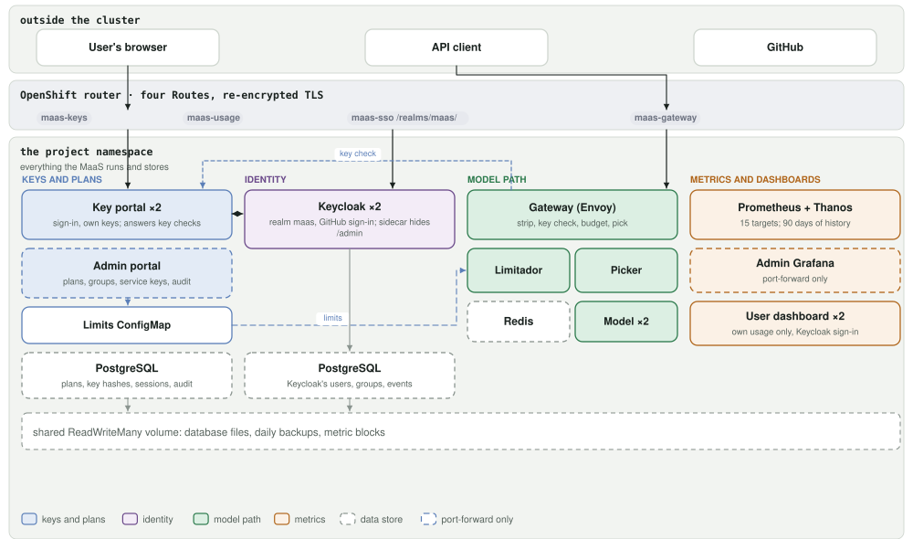
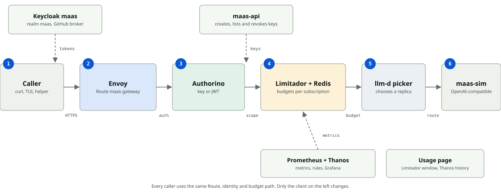

# moc-maas: Models-as-a-Service in one OpenShift namespace

This deploys Models-as-a-Service (MaaS) inside a single OpenShift project, built from the components Red Hat OpenShift AI 3.5 uses for MaaS: maas-api, Authorino, Limitador, the Kuadrant wasm-shim, the payload processors and the llm-d endpoint picker. The wiring follows the [RHOAI MaaS guide](https://github.com/rh-aiservices-bu/rhoai-maas-guide), run inside one namespace. Users sign in through Keycloak (brokered to GitHub), create API keys and call an OpenAI-compatible API. Subscriptions decide which models they can use and how many tokens they get per window. The deployment also includes a usage page for each user, Grafana dashboards for admins, and an audit trail of admin actions.

Deployment and administration are Ansible playbooks. The interactive helpers are `maas-login.py` (sign-in and an API key), `forward.sh` (the consoles on localhost) and `maas-tui.py` (a live view of the running MaaS).

## Goals

- Everything runs in the project, so its members can manage and replace any component themselves.
- Permissions stay namespaced: no ClusterRoles, no ClusterRoleBindings, nothing in platform namespaces. Components that need a Kubernetes API get a private one in the namespace (`maas-kube`).
- Upstream components run unmodified. maas-api, Authorino, Limitador, the wasm-shim, the payload processors, the endpoint picker and Envoy are as Red Hat ships them; the custom code is the usage page and the governance renderer.
- Red Hat builds are used wherever they exist, pinned by digest.
- Access is group-based: users get a subscription through their identity-provider groups, and the project's members are the MaaS admins.

## What you get

| | |
|---|---|
| Model API | `https://maas-gateway-<namespace>.<apps domain>/v1/chat/completions`, `/v1/completions`, `/v1/embeddings`, OpenAI-compatible |
| API keys | users create their own after signing in through Keycloak (brokered to GitHub); admins mint service keys for applications; keys last at most 90 days |
| Subscriptions | allowed models and token limits per window, assigned through Keycloak groups; one gateway-wide Authorino policy enforces them |
| Token budgets | enforced per user by Limitador, counted from each response's `usage.total_tokens` |
| Dashboards | a Grafana for admins (port-forward only) and a usage page for each user |
| Audit trail | admin actions (subscriptions, models, service keys, revocations); daily database backups |

## Architecture



Every MaaS component is namespaced; the deploy creates nothing cluster-scoped.

| Group | Component | Image | Role |
|---|---|---|---|
| Gateway pod | Envoy | Service Mesh `proxyv2` (Istio 1.28.10) | HTTP filters: header guard, 4 MiB body limit, payload pre-stage, wasm-shim, payload post-stage, endpoint picker |
| | Authorino | `rhcl-1/authorino-rhel9` | evaluates the AuthConfig: key or OIDC identity, subscription, model access; injects identity headers |
| | maas-api | `rhoai/odh-maas-api-rhel9` | keys, subscriptions, model list; listens on localhost only |
| | key-cleanup | OpenShift `cli` | removes expired ephemeral keys every 15 minutes |
| Model path | Limitador + Redis | `rhcl-1/limitador-rhel9`; Redis upstream | token counters per user, subscription and model |
| | wasm-shim | `rhcl-1/wasm-shim-rhel9` (v0.15.0 line) | calls Authorino and Limitador from Envoy; parses the response body in a store action for token reports |
| | Payload processors | `rhoai/odh-ai-gateway-payload-processing-rhel9` | pre: model from the body into a header; post: strips `x-maas-*`, adds `include_usage` to streams |
| | Endpoint picker | `rhoai/odh-llm-d-router-endpoint-picker-rhel9` | chooses a model pod (queue 2, KV cache 2, prefix cache 3), two replicas with leader election, `FailOpen` |
| | Model | llm-d inference simulator | a vLLM-compatible emulator, 2 pods, no GPU; replace with vLLM for real models |
| Control | `maas-kube` | etcd, kube-apiserver, `cli` | a private Kubernetes API holding the MaaS CRDs, AuthConfig, RBAC and seeded objects |
| | Governance | ConfigMap `maas-governance` | MaaSSubscription, MaaSAuthPolicy and MaaSModelRef objects in the guide's format |
| Identity | Keycloak | Red Hat build of Keycloak | realm `maas`, GitHub as the identity provider; a sidecar exposes only the realm's public paths |
| Data | PostgreSQL (2 instances) | Red Hat PostgreSQL 16 | database `maas` (usage page, audit) and `maasapi` (maas-api keys) |
| Metrics | Prometheus, Thanos, Grafana | OpenShift monitoring images; Grafana upstream | scrape the components; Thanos keeps the history on the shared volume |
| User page | usage page | UBI 9 Python 3.12 | each user's own usage from Limitador and Thanos |

Ansible does the work of maas-controller and the Kuadrant operator here: it renders the AuthConfig, Limitador's limits and the wasm-shim configuration from the governance ConfigMap (`roles/maas_governance/files/render.py`).

### One request



Every caller uses the same Route, identity and budget path.

1. The client sends `POST /v1/chat/completions` (or `/v1/completions`, `/v1/embeddings`) with `Authorization: Bearer sk-oai-...` and `model: publishers/<namespace>/models/<name>`.
2. Envoy removes routing and endpoint headers the client may have sent.
3. A body over 4 MiB gets `413`.
4. The payload pre-stage copies the body's `model` into `X-Gateway-Model-Name` and rewrites `model` to the served name; Envoy recomputes the route.
5. The route matches one of the three paths plus a known model; anything else is `404`.
6. The wasm-shim asks Authorino: maas-api validates the key and selects the subscription, and the policy rules return identity headers or `401`/`403`.
7. The wasm-shim asks Limitador whether the user is over budget; over budget is `429 Too Many Requests`.
8. The payload post-stage strips `x-maas-*` and makes streams report usage.
9. The endpoint picker returns a pod in `envoy.lb` / `x-gateway-destination-endpoint`; Envoy sends the request there over TLS, or round-robins if the picker gave none.
10. When the response ends, the wasm-shim adds `usage.total_tokens` to the user's counter.

Management paths (`/v1/models`, `/v1/subscriptions`, `/v1/api-keys`, `/maas-api/v1/...`) go to maas-api; `/maas-api/health` needs no credentials.

## Tested with

- OpenShift 4.22.14 (Kubernetes 1.35.6), Red Hat OpenShift AI 3.5.2, RHCL 1.5.0.
- The component images are pinned by digest in `roles/maas_common/defaults/main.yml`; Redis and Grafana are pinned in their manifests.

## Layout

```
playbooks/     the entry points: deploy, first-plan, admin, sso-admin, ...
manifests/     the Kubernetes manifests, named for what they deploy
roles/         one Ansible role per component
  maas_common/                        shared tasks: apply manifests, wait for rollouts, restart, find pods
  maas_secrets/                       the generated and GitHub Secrets
  maas_sso/                           Keycloak, the realm and its clients
  maas_sso_admin/                     Keycloak groups, users and memberships
  maas_kube/                          the private API server: CRDs, RBAC, kubeconfigs, seeder
  maas_governance/                    the governance data and its renderer (AuthConfig, limits, wasm config)
  maas_ipp/                           the payload processors
  maas_gateway/                       the gateway pod (Envoy, Authorino, maas-api, key-cleanup)
  maas_admin/                         admin actions over the governance data and maas-api
  maas_sync/                          the users and subscriptions reconciler
  maas_usage/files/portal.py          the usage page
  maas_smoke/                         smoke and gateway tests
  maas_grafana/files/gen-dashboards.py  renders the Grafana dashboards
sync/          desired users and subscriptions; the real set in sync/local/ (gitignored)
clusters/      one inventory per cluster: the namespace and the apps domain
docs/          architecture and request-path diagrams (from the demo slides)
tests/         unit tests and the governance render fixtures
build.sh       installs the Ansible collections, checks the build and runs the tests
forward.sh     consoles on localhost, until Ctrl-C
maas-login.py  sign in, keep an API key, chat and read the user metrics
maas-tui.py    a live terminal view of the running MaaS
```

The manifests are rendered from the cluster inventory (the namespace and the apps domain), and the playbooks set the order. Three ConfigMaps are generated at deploy time rather than kept in git: the usage page's code, Grafana's dashboards and the governance seed data.

## Prerequisites

- A namespace, with the permissions below granted to its members and service accounts.
- A ReadWriteMany PersistentVolumeClaim named `<namespace>-storage`, for database files, backups and metric blocks.
- Egress to the container registries, to GitHub (Keycloak's OAuth broker) and to PyPI (the usage page installs its PostgreSQL driver at start).
- A GitHub OAuth App, with:
  - Homepage URL: `https://maas-sso-<namespace>.<apps domain>`
  - Authorization callback URL: `https://maas-sso-<namespace>.<apps domain>/realms/maas/broker/github/endpoint`
- On the machine you deploy from: `ansible-core` 2.16 or newer, a Python that can import `kubernetes` and `yaml`, and a kubeconfig for the cluster. The playbooks, `forward.sh` and `maas-tui.py` also need `oc`; the playbooks use it to run commands inside pods.

## Permissions

Everything is namespaced. A cluster admin creates these once, in the namespace.

The Role for project members (the MaaS admins), the service accounts and their Roles are in `manifests/prereqs/`. `deploy.yml` doesn't apply them; a cluster admin applies them once and binds the members' Role to the project's members group:

```sh
oc apply -n <namespace> -f manifests/prereqs/
oc create rolebinding maas-project-admin -n <namespace> --role=maas-project-admin --group=<members group>
```

The Role includes `statefulsets` (the databases), the endpoint picker's
`poddisruptionbudgets`, and the objects the MaaS creates.

The manifests use these service accounts:

| Service account | Used by | Rules |
|---|---|---|
| `uat-epp` | endpoint picker | `get`, `list`, `watch` on `inferencepools` and `pods`; `get`, `list`, `watch` on `inferenceobjectives` and `inferencemodelrewrites` (`llm-d.ai`); `create`, `patch` on `events`; leases in `coordination.k8s.io` for leader election |
| `maas-keys` | usage page | none |

`maas-admin` and its Role are no longer used: admin actions run through `oc exec` into a gateway pod. A cluster admin may remove them.

## Quickstart

First run, on a cluster where the prerequisites and permissions above are in place:

1. Build and deploy (public Routes are opt-in):

   ```sh
   ./build.sh
   MOC_MAAS_CLIENTID=... MOC_MAAS_SECRET=... \
     ansible-playbook -i clusters/<cluster>.yml playbooks/deploy.yml -e maas_routes=true
   ```

2. Create the first subscription (Keycloak group `maas-standard`, subscription
   `standard`, 20000 tokens per 60 s):

   ```sh
   ansible-playbook -i clusters/<cluster>.yml playbooks/first-plan.yml
   ```

3. Run the smoke test (it creates and removes its own user, group and subscription):

   ```sh
   ansible-playbook -i clusters/<cluster>.yml playbooks/smoke-test.yml
   ```

4. Add a user to the subscription's group after their first GitHub sign-in:

   ```sh
   ansible-playbook -i clusters/<cluster>.yml playbooks/sso-admin.yml \
     -e maas_action=add -e maas_email=<email> -e maas_group=maas-standard
   ```

5. Put the consoles on localhost, and run the TUI under simulated load:

   ```sh
   ./forward.sh
   ansible-playbook -i clusters/<cluster>.yml playbooks/admin.yml -e maas_action=tui-setup
   ./maas-tui.py <namespace>
   ```

The sections below cover each step in detail.

## Setup

```sh
./build.sh
MOC_MAAS_CLIENTID=... MOC_MAAS_SECRET=... \
  ansible-playbook -i clusters/<cluster>.yml playbooks/deploy.yml
ansible-playbook -i clusters/<cluster>.yml playbooks/first-plan.yml
```

`deploy.yml` is safe to run again: it applies the same manifests, creates only the Secrets that are missing, and restarts deployments to pick up changed code and config. Public Routes are not created unless you ask for them (`-e maas_routes=true`). To use another namespace on the same cluster, pass `-e maas_namespace=<name>`.

The GitHub OAuth App's client ID and secret (`MOC_MAAS_CLIENTID`, `MOC_MAAS_SECRET`) are only needed while `maas-sso-github` doesn't exist yet. `playbooks/github-secret.yml` creates or rotates it on purpose. Secret values are never printed.

Tearing down without a wipe keeps the databases, the generated Secrets they need and the `maas-governance` ConfigMap with its model refs and subscriptions. A fresh install seeds the model ref and the base `standard` and `tui-*` subscriptions from the role defaults. To redeploy from scratch, run `playbooks/teardown.yml -e maas_wipe_data=true` first.

`deploy.yml` runs one play per component, in dependency order (each play has a tag, so a single part can be re-run):

| Play | Tag | What it does |
|---|---|---|
| Secrets | `secrets` | the generated Secrets (only created when missing) and the GitHub client Secret |
| Model path | `model` | model emulator, Redis, Limitador, endpoint picker, client pod |
| Databases | `databases` | PostgreSQL, the `maasapi` database, backup CronJobs |
| Keycloak | `keycloak` | Keycloak, realm `maas`, the `maas-oidc` and `maas-usage` clients |
| Governance | `governance` | the governance ConfigMap, the AuthConfig, Limitador's limits, the wasm configuration |
| Private API server | `kube` | `maas-kube`: CRDs, RBAC, tokens, seeded objects |
| Payload processors | `ipp` | the pre- and post-stages |
| Gateway | `gateway` | the gateway pod and its Envoy configuration |
| Metrics | `metrics` | the metrics bucket, Prometheus with a Thanos sidecar; Thanos Store, Query and Compactor |
| Grafana | `grafana` | the admin Grafana and its dashboards |
| User dashboard | `usage` | the usage page and its Keycloak client |
| Public addresses | `routes` | the public Routes (only with `-e maas_routes=true`) |
| Smoke test | `smoke` | the smoke test |

`first-plan.yml` creates a Keycloak group (`maas-standard`) and a subscription (`standard`, 20000 tokens per 60s) with its access policy; every value can be overridden with `-e`.

## User guide

Access comes from Keycloak groups: every subscription names the groups that own
it, and a request is charged to the highest-priority subscription among the
user's groups. A subscription can also name individual users, but adding users
to a group is the usual way (see "Add a user to a subscription"). A key keeps
the groups it was created with, so after a group change the user creates a new
key.

To sign in and keep an API key, use `maas-login.py`. Like `forward.sh` and
`maas-tui.py`, it uses the current `oc` login and reads the issuer and gateway
URL from the Routes:

```sh
./maas-login.py login            # opens Keycloak's login page; GitHub button
./maas-login.py chat "hello"     # sends to the first model in /v1/models
./maas-login.py key              # prints the stored key
./maas-login.py keys             # lists your keys
./maas-login.py revoke <id>      # revokes one of your keys
./maas-login.py metrics          # the user metrics the gateway exposes
```

The key, access token and refresh token are stored in
`~/.maas/credentials.json` with mode 0600; the file also keeps the issuer,
gateway URL and namespace. `login` prints the key once; `key` prints it again.

Without `oc`, pass the public settings; the admin provides them:

```sh
export MAAS_ISSUER=https://maas-sso-<namespace>.<apps domain>/realms/maas
export MAAS_URL=https://maas-gateway-<namespace>.<apps domain>
export MAAS_CA=/path/to/ingress-ca.crt   # the admin provides this if needed
./maas-login.py login
```

`--issuer`, `--url` and `--ca` do the same per command; `--insecure` skips
verification. The login stores the URLs and CA path, so later commands need no
flags.

A GitHub user has no Keycloak account until their first sign-in. The first
`login` creates it. If the user is not in a subscription's group yet, key
creation stops with "no subscription is assigned yet" and prints the email to
give the admin. The admin adds that email to the group (see "Add a user to a
subscription"), and the user runs `login` again.

The calls below use `$TOKEN`; the saved key works as one:

```sh
export TOKEN=$(./maas-login.py key)
```

Model calls, key management and the rest of the API are in [API](#api).

### Other ways to get a token

An admin can mint a service key for you with `admin.yml -e maas_action=service-key`
(see "Create keys"); the key works the same way.

The gateway also accepts an access token issued to `maas-oidc`. For a local
Keycloak user with a password (the kind `user-create` makes), use the direct
grant:

```sh
export TOKEN=$(curl -sk -X POST "$MAAS_ISSUER/protocol/openid-connect/token" \
  --data-urlencode grant_type=password \
  --data-urlencode client_id=maas-oidc \
  --data-urlencode username='<username>' \
  --data-urlencode password='<password>' \
  --data-urlencode 'scope=openid groups' | jq -r .access_token)
```

`maas-oidc` is a public client and has direct access grants enabled. The token
lasts 300 seconds. `-k` accepts the cluster's certificate; drop it when your CA
is trusted.

A GitHub-brokered user has no Keycloak password, so the browser flow is the
only way; `./maas-login.py login` runs it and exchanges the token for a key.

Your usage is at `https://maas-usage-<namespace>.<apps domain>/` after signing
in with GitHub. The page lists your keys (metadata only) and the usage figures.

### User metrics

A user can read their usage in three ways.

The usage page at `https://maas-usage-<namespace>.<apps domain>/` shows the
figures after a GitHub sign-in: the last 24 hours, the current window for each
subscription and model, and the user's keys.

`./maas-login.py metrics` prints the counters in Prometheus text with the
stored API key.

The gateway route returns that text for any credential:

```sh
curl -s "https://maas-gateway-<namespace>.<apps domain>/maas-usage/metrics" \
  -H "Authorization: Bearer $TOKEN"
```

Authorino and maas-api validate the key or token, and the response is fixed to
that credential's user. It has the 24-hour token, request and refusal counters,
and the current window's tokens and limit for each subscription, model and
window. A local Prometheus can scrape the route with the user's Authorization
header.

Admins see every user in the Grafana dashboards (see "Admin interfaces").

## API

Set the gateway URL and a token. The token is the API key saved by
`maas-login.py`, an access token issued to `maas-oidc`, or a service key minted
by an admin (see "Other ways to get a token"):

```sh
export MAAS_URL=https://maas-gateway-<namespace>.<apps domain>
export TOKEN=<token>
```

The `/v1/...` paths are also reachable under `/maas-api/v1/...`; the gateway
rewrites that prefix to `/v1`. The curls omit certificate flags; add `-k` when
the cluster's certificate is not trusted. The examples use `jq` to format JSON
responses.

| Method and path | What it does |
|---|---|
| `GET /v1/models` | models the token can reach; with an API key, only its subscription |
| `GET /v1/subscriptions` | subscriptions the token can reach, with their limits |
| `GET /maas-api/v1/model/<name>/subscriptions` | subscriptions that include one model; `<name>` is the model ref name |
| `GET /v1/api-keys/config` | the longest key lifetime the server allows |
| `POST /v1/api-keys` | create a key |
| `POST /v1/api-keys/search` | list keys; a non-admin sees only their own |
| `GET /v1/api-keys/<id>` | one key's metadata |
| `DELETE /v1/api-keys/<id>` | revoke a key |
| `POST /v1/api-keys/bulk-revoke` | revoke every key for a user |
| `POST /v1/chat/completions` | chat completions |
| `POST /v1/completions` | text completions |
| `POST /v1/embeddings` | embeddings |
| `GET /maas-api/health` | health; needs no credentials |
| `GET /maas-usage/metrics` | the credential's own metrics in Prometheus format |

### Models and subscriptions

```sh
curl -s "$MAAS_URL/v1/models" -H "Authorization: Bearer $TOKEN" | jq
curl -s "$MAAS_URL/v1/models" -H "Authorization: Bearer $TOKEN" | jq -r '.data[].id'
curl -s "$MAAS_URL/v1/subscriptions" -H "Authorization: Bearer $TOKEN" | jq
```

The model ids are `publishers/<namespace>/models/<name>`, where the name is the
model's `maas.moc/served-name` annotation; they are the value for the `model`
field in inference calls. With an API key the list is limited to the key's
subscription; with an OIDC token it covers every subscription the user's groups
can reach. To list the subscriptions that include one model, pass the
MaaSModelRef's name (`maas-sim` by default), which can differ from the served
name in the id:

```sh
curl -s "$MAAS_URL/maas-api/v1/model/<name>/subscriptions" -H "Authorization: Bearer $TOKEN" | jq
```

### API keys

```sh
# the configured limits
curl -s "$MAAS_URL/v1/api-keys/config" -H "Authorization: Bearer $TOKEN" | jq

# create; the key is shown once
curl -s -X POST "$MAAS_URL/v1/api-keys" \
  -H "Authorization: Bearer $TOKEN" -H 'Content-Type: application/json' \
  -d '{"name":"laptop","description":"my laptop","expiresIn":"720h"}' | jq

# search
curl -s -X POST "$MAAS_URL/v1/api-keys/search" \
  -H "Authorization: Bearer $TOKEN" -H 'Content-Type: application/json' \
  -d '{"filters":{"status":["active"]},"sort":{"by":"created_at","order":"desc"},"pagination":{"limit":50,"offset":0}}' | jq

# one key
curl -s "$MAAS_URL/v1/api-keys/<id>" -H "Authorization: Bearer $TOKEN" | jq

# revoke one
curl -s -X DELETE "$MAAS_URL/v1/api-keys/<id>" -H "Authorization: Bearer $TOKEN" | jq

# revoke every key for a user
curl -s -X POST "$MAAS_URL/v1/api-keys/bulk-revoke" \
  -H "Authorization: Bearer $TOKEN" -H 'Content-Type: application/json' \
  -d '{"username":"<username>"}' | jq
```

`name` is required for a normal key. `expiresIn` is a Go duration up to 90
days and defaults to that maximum (one hour for an ephemeral key).
`subscription` pins the key to one subscription; without it the key uses the
highest-priority subscription the user can reach. `ephemeral: true` makes a
key that lasts at most an hour. Search filters are `status` (active, revoked,
expired), `username` (admin only), `nameContains`, `descriptionContains`,
`subscription`, `hasExpiration`, `hasBeenUsed`, `createdAfter`, `createdBefore`,
`expiresAfter`, `expiresBefore`, `lastUsedAfter` and `includeEphemeral`;
pagination is `limit` (up to 100) and `offset`. A non-admin can search and
bulk-revoke only their own keys. The key value is returned once at creation and
never again.

### Inference

```sh
MODEL=$(curl -s "$MAAS_URL/v1/models" -H "Authorization: Bearer $TOKEN" | jq -r '.data[0].id')

curl -s "$MAAS_URL/v1/chat/completions" \
  -H "Authorization: Bearer $TOKEN" -H 'Content-Type: application/json' \
  -d "{\"model\":\"$MODEL\",\"messages\":[{\"role\":\"user\",\"content\":\"hello\"}],\"max_tokens\":64}" | jq

curl -s "$MAAS_URL/v1/completions" \
  -H "Authorization: Bearer $TOKEN" -H 'Content-Type: application/json' \
  -d "{\"model\":\"$MODEL\",\"prompt\":\"hello\",\"max_tokens\":32}" | jq

curl -s "$MAAS_URL/v1/embeddings" \
  -H "Authorization: Bearer $TOKEN" -H 'Content-Type: application/json' \
  -d "{\"model\":\"$MODEL\",\"input\":\"hello\"}" | jq
```

Add `"stream": true` to a chat or completion request for server-sent events.

### Health and errors

`GET /maas-api/health` needs no credentials:

```sh
curl -s "$MAAS_URL/maas-api/health"
```

The other paths return 401 for a missing or invalid credential, 403 when the
subscription or model does not allow the request, 404 for an unknown path or
model, 413 for a request body over 4 MiB, and 429 when the token budget is
exhausted.

## Admin interfaces

| Interface | What it is for |
|---|---|
| `playbooks/admin.yml` | subscriptions, access policies, models, keys, service keys, audit |
| `playbooks/sso-admin.yml` | Keycloak groups, users and memberships |
| `playbooks/sync.yml` | reconcile subscriptions and group memberships from `sync/`; check by default |
| `./forward.sh` | maas-api (8090), `maas-kube` (16443), the Keycloak admin console (9443), Grafana (3000) and Prometheus (9090) on localhost |
| Grafana | the admin dashboards, through `forward.sh` |
| usage page | each user's own usage at `https://maas-usage-<namespace>.<apps domain>/` |
| `maas-tui.py` | a live view of the running MaaS under simulated load |
| `maas-kube` | the private API with the MaaS CRDs; `forward.sh` plus the `maas-ops` token gives `kubectl` access |

For users without cluster access, the admin provides the issuer and gateway
URLs. If the ingress CA is private, the admin also exports the CA bundle and
sends it with the URLs:

```sh
oc get cm -n <namespace> maas-ingress-ca -o jsonpath='{.data.ca-bundle\.crt}' > ingress-ca.crt
```

The user passes that file as `MAAS_CA` or `--ca`, as above.

The governance ConfigMap `maas-governance` is the editable input (subscriptions,
access policies, models). `admin.yml` edits it, re-renders the AuthConfig,
Limitador's limits and the wasm configuration, and restarts the gateway pods one
at a time.

### Find the actions

Both playbooks list their actions and arguments:

```sh
ansible-playbook -i clusters/<cluster>.yml playbooks/admin.yml -e maas_action=help
ansible-playbook -i clusters/<cluster>.yml playbooks/sso-admin.yml -e maas_action=help
```

### Add a user to a subscription

Subscriptions are normally granted to Keycloak groups, so the path is user ->
Keycloak group -> subscription and its access policy. A subscription can name
individual users instead (`maas_users`), but the group route is the usual one.

1. Find the subscription and its groups: `admin.yml -e maas_action=subscriptions`.
2. Get the group into the subscription. For a new subscription:
   `admin.yml -e maas_action=subscription-set -e maas_subscription=standard -e maas_groups=maas-standard -e maas_limits=20000/60s`.
   For an existing one:
   `admin.yml -e maas_action=group-map -e maas_group=maas-standard -e maas_subscription=standard`.
3. The user must have signed in through GitHub once, so Keycloak has their
   account. Add them by email:
   `sso-admin.yml -e maas_action=add -e maas_email=<email> -e maas_group=maas-standard`.
4. Check the membership: `sso-admin.yml -e maas_action=user-groups -e maas_email=<email>`.
5. Existing keys keep the groups they were issued under. The user creates a new
   key, or you revoke the old one, to pick up the subscription.

To remove access, reverse step 3 (`maas_action=remove`) and revoke the user's
keys with `admin.yml -e maas_action=revoke-user`.

### Sync users and subscriptions from files

The sync playbook reads two YAML files and makes the subscriptions and group
memberships match them. The tracked files in `sync/` are the defaults: the
three TUI subscriptions and an empty user list. The TUI's users are created
for each session and are not Keycloak accounts, so there is nothing to sync
for them. Put the real files in `sync/local/`, which `.gitignore` excludes,
and pass `-e maas_sync_dir=$PWD/sync/local`.

A subscription has a name, groups, limits and a priority. The priority must
be unique among the subscriptions left after the run. `models` can be left
out, which serves every model, and `users` can be left out, which keeps the
subscription's direct users as they are. A user has an email and a
subscription; the sync adds the email to the subscription's first group. The
user must have signed in once, otherwise the run lists them as pending.

```yaml
# sync/local/subscriptions.yaml
subscriptions:
  - name: standard
    groups: [maas-standard]
    limits: 20000/60s
    priority: 0
```

```yaml
# sync/local/users.yaml
users:
  - email: ada@example.com
    subscription: standard
```

The playbook only reports unless `-e maas_sync_apply=true` is given. It fails
when something is missing or different, when a user is pending, and when the
cluster has a subscription or membership the files do not list:

```sh
ansible-playbook -i clusters/<cluster>.yml playbooks/sync.yml \
  -e maas_sync_dir=$PWD/sync/local
```

Apply makes the additions and updates, but still reports extras and fails
until they are added to the files or removed with prune:

```sh
ansible-playbook -i clusters/<cluster>.yml playbooks/sync.yml \
  -e maas_sync_dir=$PWD/sync/local -e maas_sync_apply=true
```

Prune removes a user from a group the files manage, or deletes a subscription
the files do not list. It never deletes a Keycloak account or a group. Keys
keep the groups they were issued with, so revoke them with
`admin.yml -e maas_action=revoke-user` when access is removed.

### Create subscriptions and users

| Task | Command |
|---|---|
| Create or replace a subscription and its access policy | `admin.yml -e maas_action=subscription-set -e maas_subscription=<s> -e maas_groups=<g[,g]> -e maas_limits=24000/24h,2000/1h [-e maas_priority=10] [-e maas_models=<m[,m]>] [-e maas_users=<u[,u]>]` |
| Remove a subscription and its policy | `admin.yml -e maas_action=subscription-delete -e maas_subscription=<s>` |
| Add a group to an existing subscription | `admin.yml -e maas_action=group-map -e maas_group=<g> -e maas_subscription=<s>` |
| Create a local test user | `sso-admin.yml -e maas_action=user-create -e maas_user=<u> -e maas_group=<g> -e maas_password=<pw>` |
| Add a signed-in GitHub user | `sso-admin.yml -e maas_action=add -e maas_email=<email> -e maas_group=<g>` |

### Create keys

Users create their own keys after signing in (`maas-login.py login`, or
`POST /maas-api/v1/api-keys` with their token; see the user guide). For an
application, mint a service key:

```sh
admin.yml -e maas_action=service-key -e maas_owner=<owner> -e maas_key_name=<name> \
  -e maas_subscription=<s> -e maas_days=30 [-e maas_secret_name=<secret>]
```

The key is printed unless `maas_secret_name` stores it in a Secret. Service
keys must be re-minted at least every 90 days (`API_KEY_MAX_EXPIRATION_DAYS`);
changing the maximum applies to new keys only.

### Run the tests

| Test | Command |
|---|---|
| Smoke: 8 checks through the public Route, with a temporary user, group and subscription | `ansible-playbook -i clusters/<cluster>.yml playbooks/smoke-test.yml` |
| Gateway routes and guards | `MOC_MAAS_KEY=sk-oai-... ansible-playbook -i clusters/<cluster>.yml playbooks/test-gateway.yml` |
| Users and subscriptions match the files | `ansible-playbook -i clusters/<cluster>.yml playbooks/sync.yml -e maas_sync_dir=$PWD/sync/local` |
| First subscription | `ansible-playbook -i clusters/<cluster>.yml playbooks/first-plan.yml` |
| Backups and the restore check | `ansible-playbook -i clusters/<cluster>.yml playbooks/backup-now.yml` then `restore-test.yml` |

`deploy.yml --tags smoke` runs the smoke test as the last deploy stage.

### Run the TUI

```sh
ansible-playbook -i clusters/<cluster>.yml playbooks/admin.yml -e maas_action=tui-setup
./maas-tui.py <namespace>
```

`tui-setup` creates the three stress subscriptions (`tui-chat` 10000/60s,
`tui-tool-call` 100000/60s, `tui-research` 30000/60s, one per request type).
The TUI mints one key per simulated user (`tui-<session>-<n>`), sends real
traffic through the gateway, shows requests per replica, counted tokens and
429s, and revokes the keys on exit. `admin.yml -e maas_action=tui-cleanup`
revokes any keys left by an interrupted session.

### All admin actions

Run everything from the repository root; `<cluster>` is your inventory under `clusters/`.

| Command | What it does |
|---|---|
| `admin.yml -e maas_action=subscriptions` | list subscriptions, policies and models |
| `admin.yml -e maas_action=subscription-set -e maas_subscription=standard -e maas_groups=maas-standard -e maas_limits=24000/24h,2000/1h` | create or replace a subscription and its access policy |
| `admin.yml -e maas_action=subscription-delete -e maas_subscription=standard` | remove both |
| `admin.yml -e maas_action=group-map -e maas_group=<g> -e maas_subscription=<s>` | add a group to a subscription and its policy (`group-unmap` removes it) |
| `admin.yml -e maas_action=models` / `model-set -e maas_model=<m>` / `model-delete -e maas_model=<m>` | the model list |
| `admin.yml -e maas_action=render` | re-render and apply everything (after a manual governance edit) |
| `admin.yml -e maas_action=keys [-e maas_username=<user>]` | list keys |
| `admin.yml -e maas_action=revoke -e maas_key_id=<id>` | revoke one key |
| `admin.yml -e maas_action=revoke-user -e maas_username=<user>` | list the user's keys (dry run; `-e maas_dry_run=false` revokes them) |
| `admin.yml -e maas_action=service-key -e maas_owner=<owner> -e maas_key_name=<name> -e maas_subscription=<s> -e maas_days=30 [-e maas_secret_name=<secret>]` | mint a service key |
| `admin.yml -e maas_action=tui-setup` | create the three stress subscriptions `maas-tui.py` uses |
| `admin.yml -e maas_action=tui-cleanup` | revoke the `tui-` keys |
| `admin.yml -e maas_action=audit [-e maas_since=<timestamp>]` | the audit trail |
| `sso-admin.yml -e maas_action=<action>` | Keycloak groups, users and memberships |
| `MOC_MAAS_KEY=... test-gateway.yml` | the gateway's routes and guards |
| `smoke-test.yml` | the end-to-end smoke test |
| `backup-now.yml`, `restore-test.yml`, `teardown.yml` | backups, restore check, removal |
| `./forward.sh` | maas-api, the Keycloak console, Grafana, Prometheus and `maas-kube` on localhost |
| `./maas-tui.py` | a live view of simulated users with real keys |

### Operations

To offboard a user, run `revoke-user` with the default dry run, check the list, then run it with `-e maas_dry_run=false`. Keys keep the groups they were issued under until they expire, so revoking the keys is the offboarding step.

Service keys must be re-minted at least every 90 days (`API_KEY_MAX_EXPIRATION_DAYS`). Changing the maximum applies to new keys only.

A subscription change re-renders the governance data and restarts the gateway pods one at a time, so requests keep being served.

When a component is down:

| Down | What happens |
|---|---|
| `maas-kube` | inference keeps answering from Authorino's and maas-api's caches; configuration changes wait |
| one gateway pod | the other serves |
| Keycloak | existing keys work; new tokens fail |
| `maas-ipp-pre` | inference gets 404 (no model header to route on) |
| `maas-ipp-post` | inference is refused (it fails closed) |
| Limitador | requests pass uncounted |
| the endpoint picker | losing one replica is covered: the standby takes the lease. A full outage, including a deployment update, returns 500. `FailOpen` covers pool selection while the EPP is up; an absent EPP is a hard dependency. |
| Redis | Limitador reports errors; requests pass uncounted |

The MaaS Prometheus watches for unreachable targets, a filling volume, failed metric uploads and a halted compactor. Firing alerts show in Grafana's "MaaS serving" dashboard and at Prometheus's `/alerts`.

On billing: only the three model paths are exposed and charged from `usage.total_tokens`. The other paths in the guide (`/v1/responses`, `/v1/messages`, arbitrary paths) can run unbilled.

## Adapting to your cluster

The namespace is a variable everywhere: the manifests render for it, the playbooks and generated ConfigMaps read it from the inventory, and the shared volume is expected as `<namespace>-storage`. For each cluster, copy the example inventory in `clusters/` and set:

- `maas_namespace`: the namespace to deploy into by default (any other with `-e maas_namespace=<name>`)
- `maas_apps_domain`: the cluster's apps domain, which the Route hostnames and the Keycloak issuer embed
- `maas_s3_endpoint`: the object-storage endpoint the metrics bucket is reached through, and the COSI class names in `roles/maas_metrics/defaults/main.yml`
- `maas_s3_ca`: the PEM of the CA that signs the S3 endpoint's certificate; leave it out to use the cluster's ingress CA
- `maas_route_concurrent_tcp` and `maas_route_rate_http`: the router's per-address limits on the public Routes
- `maas_gateway_replicas`, `maas_envoy_concurrency`: gateway replicas and Envoy worker threads
- `maas_gateway_drain_seconds`: how long a stopping gateway pod keeps serving, so rollouts and node drains don't cut generations (default 120)

## Current limitations

- The model is an emulator. To serve a real model, replace the model Deployment with vLLM on GPUs, keeping the same `--ssl-certfile` and `--ssl-keyfile` arguments and a certificate for the Service's name. The endpoint picker scrapes metrics over TLS but does not verify the certificate, because it connects to a pod IP and has no name to check.
- Revoking a key or changing access can take up to 60 seconds (`maas_cache_ttl`), Authorino's cache.
- Keys keep the groups they were created with; group changes do not update existing keys.
- There is one global key lifetime (`API_KEY_MAX_EXPIRATION_DAYS`, 90 days); service keys must be re-minted.
- Redis has no password and no persistence; restarting Redis resets the current budget windows.
- The usage page installs its PostgreSQL driver from PyPI at start; a built image would remove that dependency.
- The private API server keeps its data on an emptyDir; a restart reseeds it from the governance ConfigMap.
- The EPP has two replicas and leader election, with a PodDisruptionBudget and best-effort anti-affinity. Only the leader is Ready. The standby keeps its datastore warm and takes the lease when the leader goes. The Deployment uses `Recreate`; a rolling update would wait for a new pod to become Ready while the old leader still holds the lease, so an update is a short full outage. A full outage still returns 500. The PodDisruptionBudget stops a voluntary eviction of the leader, so a drain of the leader's node waits until the budget is removed or the pod is deleted directly.
- Nothing rotates secrets on a schedule. GitHub OAuth App client secrets do not expire; rotate the GitHub one with `playbooks/github-secret.yml`. The generated Secrets are created once; rotating one means deleting it and re-running `deploy.yml`. API keys expire and are re-minted.
- A cluster admin can read any namespace Secret and the Keycloak database, including the GitHub app's client secret. In-cluster RBAC, external secret stores and etcd encryption reduce or detect that exposure, but do not prevent it. If the secret must be hidden from the cluster admin, the GitHub broker must run outside their trust domain.
- The project Role grants `secrets` to namespace members, and any member who can create pods can mount a namespace Secret. The trust boundary is the project, not the individual user.
- The usage service's internal metrics port 9100 trusts the `X-MaaS-Username` and `X-MaaS-Group` headers. The gateway injects them, but the platform NetworkPolicy allows all intra-namespace traffic, so any pod in the namespace can call `/user-metrics` directly and spoof another user's usage. Fix with mTLS or a shared secret between the gateway and the usage service, or with a narrower platform policy. Otherwise the namespace is the trust boundary.
